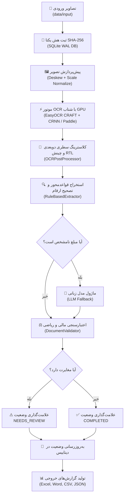

# 🧾 حسابیار (Hesabyar)

### Production-Grade Financial Document OCR & Extraction System
**سامانه هوشمند، بومی و صنعتی پردازش تصویر، نویسه‌خوانی (OCR) و استخراج داده‌های اسناد مالی ایران**

[](https://www.python.org/)
[](https://developer.nvidia.com/cuda-toolkit)
[](https://pytorch.org/)
[](https://github.com/PaddlePaddle/PaddleOCR)
[](https://sqlite.org/)
[-success?style=for-the-badge&logo=pytest&logoColor=white)](https://pytest.org/)
[](LICENSE)

---

## 📌 معرفی پروژه (Overview)

**حسابیار** یک پایپ‌لاین نرم‌افزاری سطح تجاری و آماده محیط عملیاتی (Production-Grade) است که به طور تخصصی برای اسناد مالی، فاکتورهای شرکتی، رسیدهای دستگاه‌های کارتخوان (POS)، قبوض خدماتی، اسکرین‌شات‌های اپلیکیشن‌های پرداخت موبایلی و سامانه‌های حمل‌ونقل شهری (اسنپ و تپسی) در ایران طراحی و مهندسی شده است.

این سامانه با تکیه بر **پردازشگرهای گرافیکی (NVIDIA CUDA GPU)** و الگوریتم‌های ابتکاری در سطح بینایی ماشین و منطق مالی، چالش‌های تاریخی OCR در زبان فارسی (مانند حروف متصل، اعداد چندزبانه، کیفیت پایین اسکرین‌شات‌ها و اشتباه ارقام صفر و پنج) را به طور قطعی حل کرده است.

---

## 🚀 ویژگی‌های کلیدی و مزیت‌های فنی

### ۱. شتاب‌دهی سخت‌افزاری با کارت گرافیک (CUDA GPU Acceleration)
- **پردازش فوق‌سریع**: کاهش زمان پردازش هر سند از چندین دقیقه به **۰.۳ الی ۰.۵ ثانیه** با استفاده از کارت‌های گرافیک NVIDIA (تست‌شده روی GeForce RTX 3080).
- **Graceful Fallback**: تشخیص بلادرنگ سخت‌افزار؛ در صورت عدم دسترسی به کارت گرافیک، پردازش به صورت خودکار و بدون افت دقت به CPU و RAM منتقل می‌شود.
- **معماری ماژولار موتورها**: پشتیبانی همزمان از **EasyOCR** (ترکیب CRAFT Text Detector و CRNN Recognizer)، **PaddleOCR** (`PP-OCRv5`) و **Tesseract**.

### ۲. پیش‌پردازش هوشمند و تطبیقی تصویر (Smart Image Preprocessing)
- **حفظ فونت‌های دیجیتال**: جلوگیری از باینریزاسیون مخرب روی اسکرین‌شات‌های رنگی اپلیکیشن‌های بانکی و رسیدهای دیجیتال جهت تضمین حداکثر دقت بازشناسی حروف.
- **تراز زاویه خودکار (Deskewing)**: تصحیح خودکار چرخش اسناد و رسیدهای فیزیکی با الگوریتم‌های مورفولوژی و حداقل مستطیل محاطی.
- **نرمال‌سازی ابعاد (Dimension Normalization)**: افزایش هوشمند رزولوشن متون کوچک برای رساندن ارتفاع حروف به محدوده بهینه شبکه‌های عصبی عمیق.
- **بهبود کنتراست اسناد حرارتی (CLAHE)**: تقویت کنتراست متن در رسیدهای کم‌رنگ و مخدوش دستگاه‌های پوز.

### ۳. الگوریتم اختصاصی ادغام افقی سطرها (2D Layout & RTL Line Clustering)
- **شناسایی جفت‌های برچسب-مقدار (Label-Value Pairing)**: رسیدهای مالی ایران دارای چینش راست‌به‌چپ با برچسب در سمت راست (`مبلغ:`) و مقدار در سمت چپ (`۷۸۹,۰۰۰ ریال`) هستند. حسابیار با کلاسترینگ دوبعدی بر اساس ارتفاع و هم‌پوشانی عمودی، کادرهای مربوط به یک خط را شناسایی و ادغام می‌کند.
- **ترتیب خوانش طبیعی فارسی (RTL Reading Order)**: مرتب‌سازی کادرها از بالا به پایین و در هر سطر از راست به چپ.

### ۴. استخراج قطعی و تصحیح آرتیفکت‌های مالی ایران (Financial Rules & Correction)
- **تصحیح خطای صفر و پنج**: حل آرتیفکت کلاسیک شناسایی صفرهای توخالی (`۰۰۰`) به عنوان رقم ۵ عربی (`٥٥٥`) در مبالغ ریالی با تابع قطعی `normalize_rial_ocr_artifacts`.
- **پشتیبانی از تاریخ‌های حروفی شمسی**: تبدیل انواع تاریخ‌های متنی نظیر `۲۹ مهر ۱۴۰۳` به استاندارد عددی `1403/07/29`.
- **شناسایی انواع اسناد بانکی**:
  - قبوض خدماتی و تلفن (`bill_payment`) با شناسه پرداخت و شماره ارجاع.
  - تراکنش‌های کارت‌به‌کارت (`card_transfer`) با کارت مبدأ، کارت مقصد و کد پیگیری.
  - رسیدهای سفر و تردد شهری (`trip_receipt`) اسنپ و تپسی.
  - رسید تراکنش پایانه پوز (`pos_slip`) با شناسه ترمینال و کد پیگیری.
  - فاکتورهای رسمی و غیررسمی کالا و خدمات (`invoice`).
- **استخراج شماره کارت‌های بانکی**: پشتیبانی از شماره کارت‌های ۱۶ رقمی، با خط فاصله و ماسک‌شده (نظیر `6393-46**-****-3046` و `****-3487`).

### ۵. موتور اعتبارسنجی مالی (Financial Validator)
- بررسی تطابق ریاضی جمع اقلام فاکتور با مبلغ نهایی.
- کشف خطاهای ضریب ۱۰ (تداخل مبالغ ریال و تومان در اقلام فاکتور).
- اعتبارسنجی چک‌سام کارت‌های بانکی با الگوریتم لوان (**Luhn Algorithm**) بدون خطا روی کارت‌های ماسک‌شده.
- فعال‌سازی خودکار وضعیت `NEEDS_REVIEW` در صورت بروز هرگونه تناقض عددی.

### ۶. تاب‌آوری، مدیریت وضعیت و پردازش دسته‌ای موازی
- **بانک اطلاعاتی محلی SQLite در حالت WAL**: ذخیره پایدار وضعیت پردازش فایل‌ها با هش اختصاصی SHA-256 جهت جلوگیری از پردازش فایل‌های تکراری (Idempotency).
- **توقف و ازسرگیری خودکار (Pause / Resume)**: امنیت کامل در صورت توقف ناگهانی یا دستی (`Ctrl+C`)؛ برنامه در اجرای بعدی دقیقاً از اولین سند صف ادامه می‌دهد.
- **پردازش چندریسمانی (Parallel Worker Pool)**: پردازش همزمان دسته‌های اسناد متناسب با تعداد هسته‌های سیستم.

### ۷. موتور خروجی و گزارش‌گیری چندقالبه (Multi-format Exporters)
- **Microsoft Excel (`.xlsx`)**: خروجی کاملاً راست‌به‌چپ با فرمت‌بندی رسمی مالی، رنگ‌آمیزی وضعیت‌ها و شیت خلاصه آماری KPI.
- **Microsoft Word (`.docx`)**: گزارش تحلیلی اجرایی شامل جداول تفکیکی و خلاصه‌های کلیدی.
- **CSV سازگار با اکسل (`utf-8-sig`)**: خروجی متنی با Byte Order Mark جهت باز شدن صحیح حروف فارسی در نرم‌افزارهای حسابداری و اکسل.
- **JSON ساختاریافته (`.json`)**: ارائه متاداده‌های کامل اسناد منطبق بر ساختار Pydantic برای یکپارچه‌سازی با سامانه‌های ERP.

### ۸. رابط خط فرمان کاملاً انگلیسی و استاندارد (Professional CLI)
- کلیه لاگ‌ها، جداول، پیام‌ها و اعلان‌های تعاملی در کنسول مطابق استانداردهای بین‌المللی به زبان **انگلیسی** ارائه شده‌اند.

---

## 🏗️ ساختار درختی پروژه (Project Layout)

```plaintext
Hesabyar/
├── data/                           # پوشه داده‌ها (Local Storage)
│   ├── input/                      # تصاویر و اسناد ورودی (jpg, png, tiff)
│   ├── output/                     # فایل‌های تولیدشده Excel, Word, CSV و JSON
│   ├── cache/                      # تصاویر تمیز و بهینه‌سازی‌شده موقت
│   ├── ground_truth/               # دیتاست برچسب‌خورده استاندارد برای بنچمارک
│   ├── hesabyar_state.db           # دیتابیس SQLite WAL مدیریت وضعیت اسناد
│   └── hesabyar.log                # فایل لاگ‌های چرخشی سیستم
├── src/
│   └── hesabyar/
│       ├── __init__.py             # متاداده برنامه و نسخه‌بندی
│       ├── cli.py                  # نقطه ورود، منوها و رابط انگلیسی خط فرمان (Typer + Rich)
│       ├── core/                   # زیرساخت بنیادین
│       │   ├── config.py           # مدیریت تنظیمات محیطی (.env) با Pydantic Settings
│       │   ├── logger.py           # سیستم لاگینگ ساختاریافته با کنسول و فایل چرخشی
│       │   └── exceptions.py       # کلاس‌های خطای سفارشی سیستم
│       ├── db/
│       │   └── state_manager.py    # مدیریت وضعیت اسناد، ثبت هش SHA-256 و صف SQLite
│       ├── models/
│       │   └── schemas.py          # اسکیمای اعتبارسنجی داده‌ها (Pydantic Models)
│       ├── processing/
│       │   ├── image_utils.py      # توابع کمکی بارگذاری و ذخیره تصویر با پشتیبانی مسیرهای فارسی
│       │   └── preprocessor.py     # اصلاح زاویه (Deskew)، نورپردازی، CLAHE و نرمال‌سازی ابعاد
│       ├── ocr/
│       │   ├── engine.py           # ماژول‌های موتورهای OCR (EasyOCR GPU, PaddleOCR, Tesseract)
│       │   └── post_processor.py   # پاک‌سازی حروف، تصحیح اعداد، ادغام سطری و مرتب‌سازی RTL
│       ├── extraction/
│       │   ├── rules.py            # استخراج قطعی فیلدها با Regex و نرمال‌سازی مالی
│       │   ├── validator.py        # اعتبارسنجی ریاضی مبالغ، چک‌سام کارت و تاریخ شمسی
│       │   └── llm_parser.py       # ماژول Fallback مبتنی بر مدل‌های زبانی ساختاریافته (LLM)
│       ├── pipeline/
│       │   └── batch_manager.py    # موتور پردازش موازی، صف کارها، ایزولاسیون خطا و توقف/ادامه
│       └── exporters/
│           ├── excel_csv.py        # خروجی Excel راست‌به‌چپ و CSV با انکودینگ utf-8-sig
│           ├── word.py             # تولید اسناد گزارش تحلیلی Word (.docx)
│           └── report.py           # گزارش تجمیعی آماری و خروجی JSON
├── tests/                          # آزمون‌های خودکار کیفیت و صحت
│   ├── unit/                       # تست‌های واحد ماژول‌های پردازش، دیتابیس، استخراج و اعتبارسنجی
│   └── integration/                # تست‌های سرتاسری پایپ‌لاین و آزمون اختصاصی تصاویر واقعی
├── scripts/
│   └── benchmark.py                # ارزیابی خودکار دقت نویسه‌ها (CER) و ارقام (DER) روی Ground Truth
├── pyproject.toml                  # فایل مدیریت پکیج، بیلد و وابستگی‌ها
└── README.md                       # مستندات جامع راهنمای سامانه
```

---

## 🔄 جریان کار و معماری پایپ‌لاین (Architecture)



---

## 💻 راهنمای نصب و راه‌اندازی (Installation)

### پیش‌نیازها
1. **پایتون**: نسخه **3.10** یا بالاتر.
2. **کارت گرافیک (اختیاری جهت شتاب‌دهی)**: کارت گرافیک NVIDIA با درایور مناسب و پشتیبانی از CUDA 11.8 یا 12.x (در صورت عدم وجود کارت گرافیک، سیستم به صورت خودکار از پردازنده مرکزی CPU استفاده می‌کند).

### گام‌های نصب

```bash
# ۱. کلون کردن یا ورود به پوشه پروژه
cd "G:\Python Projects\OCR APP\For mom\Hesabyar"

# ۲. ایجاد محیط مجازی پایتون (توصیه‌شده)
python -m venv venv
venv\Scripts\activate      # در ویندوز
# source venv/bin/activate # در لینوکس یا مک

# ۳. ارتقای ابزار pip
python -m pip install --upgrade pip

# ۴. نصب بسته در حالت توسعه (Editable Mode)
pip install -e .
```

### نصب وابستگی‌های شتاب‌دهنده GPU (در صورت وجود کارت گرافیک NVIDIA)
برای بهره‌مندی از حداکثر توان پردازشگر گرافیکی، نسخه PyTorch با پشتیبانی از CUDA را نصب فرمایید:
```bash
pip install torch torchvision --index-url https://download.pytorch.org/whl/cu118
pip install easyocr
```

---

## ⚙️ پیکربندی تنظیمات (`.env`)

یک فایل نمونه با نام `.env.example` در ریشه پروژه قرار دارد. برای شخصی‌سازی تنظیمات، آن را به `.env` کپی کنید:

```env
# محیط اجرایی: development / production
HESABYAR_ENV=production

# موتور پیش‌فرض OCR: easyocr (پیش‌فرض با شتاب GPU) / paddleocr / tesseract
OCR_ENGINE=easyocr
OCR_LANG=fa
USE_GPU=true

# همزمانی و کارگران پردازش موازی
MAX_WORKERS=4
BATCH_SIZE=20

# تنظیمات لاگینگ
LOG_LEVEL=INFO

# کلیدهای مدل زبانی برای سناریوهای فاکتورهای نامنظم (اختیاری)
GEMINI_API_KEY=
LLM_MODEL=gemini-2.5-flash
```

---

## 📖 راهنمای کامل دستورات خط فرمان (CLI Reference)

کلیه دستورات با استفاده از دستور سراسری `hesabyar` (یا `python -m hesabyar.cli`) در ترمینال قابل اجرا هستند:

### ۱. نمایش مشخصات سیستم و کارت گرافیک (`info`)
مشاهده مشخصات کارت گرافیک شناسایی‌شده، نسخه موتورها و مسیرهای فعال:
```bash
hesabyar info
```

### ۲. مقداردهی و بررسی پوشه ورودی (`start`)
اسکن خودکار پوشه `data/input`، کشف اسناد جدید و ثبت در دیتابیس SQLite:
```bash
hesabyar start
```

### ۳. اجرای سرتاسری پایپ‌لاین پردازش موازی (`run`)
اجرای پردازش اسناد صف با شتاب GPU، درصد پیشرفت بلادرنگ و قابلیت توقف امن با `Ctrl+C`:
```bash
# اجرای خودکار تمام اسناد صف
hesabyar run

# تعیین تعداد پردازش‌های همزمان
hesabyar run --workers 6

# محدود کردن تعداد فایل‌های این نوبت
hesabyar run --limit 10

# تلاش مجدد روی فایل‌هایی که قبلاً با خطا مواجه شدند
hesabyar run --retry-failed
```

### ۴. مشاهده داشبورد آماری وضعیت اسناد (`status`)
نمایش جدول آماری وضعیت کلیه اسناد (تعداد تکمیل‌شده، نیازمند بازبینی و خطادار) به همراه فهرست آخرین پرونده‌ها:
```bash
hesabyar status --limit 15
```

### ۵. پیش‌پردازش مستقل تصاویر (`preprocess`)
اجرای مستقل تراز زاویه و بهینه‌سازی تصاویر و ذخیره در کش:
```bash
hesabyar preprocess --method none
```

### ۶. استخراج متن خام و مختصات کادرها (`ocr`)
اجرای تست OCR روی اسناد به همراه نمایش Bounding Box کلمات:
```bash
hesabyar ocr --boxes
```

### ۷. استخراج ساختاریافته و اعتبارسنجی مقادیر (`extract`)
پردازش مجدد منطقی فیلدها و اعتبارسنجی مالی مبالغ:
```bash
hesabyar extract
```

### ۸. تولید گزارش‌های نهایی (`export`)
تولید گزارش‌های تحلیلی مدیریتی در پوشه `data/output`:
```bash
# تولید همزمان تمامی فرمت‌ها (Excel + Word + CSV + JSON)
hesabyar export --format all

# تولید فقط گزارش اکسل
hesabyar export --format excel

# تولید گزارش ورد مدیریتی
hesabyar export --format word
```

### ۹. بازنشانی وضعیت اسناد (`reset`)
بازگرداندن پرونده‌ها به وضعیت `PENDING` جهت پردازش مجدد از ابتدا:
```bash
# بازنشانی تمامی پرونده‌ها با تاییدیه خودکار
hesabyar reset --target all --force

# بازنشانی تنها پرونده‌های خطادار
hesabyar reset --target failed
```

### ۱۰. اجرای بنچمارک روی دیتاسِت مرجع (`benchmark`)
اجرای ارزیابی دقت و محاسبه خطای نویسه‌ها (CER)، خطای ارقام (DER) و دقت مبالغ مالی:
```bash
hesabyar benchmark
```

---

## 🧪 تست‌های خودکار و تضمین کیفیت (Testing)

پروژه دارای **۴۴ تست خودکار جامع** (واحد و یکپارچگی) است که تمام زیرسیستم‌ها را پوشش می‌دهند:

```bash
# اجرای تمامی تست‌های پروژه
pytest

# اجرای تست‌های یکپارچگی تصاویر واقعی اسناد
pytest tests/integration/test_user_images.py -v
```

### نتایج تست روی نمونه‌های واقعی موجود در پروژه:
- **`meli-1.jpg`** (رسید پرداخت قبض تلفن ثابت بانک ملی):
  - استخراج دقیق مبلغ `789,000 ریال`
  - تاریخ شمسی `1403/08/02`
  - شماره کارت `****-****-****-3487`
  - شماره ارجاع `574398955652`
  - وضعیت اعتبارسنجی: **COMPLETED ✓** (بدون نیاز به بازبینی)
- **`meli-2.jpg`** (رسید پرداخت قبض تلفن ثابت بانک ملی):
  - استخراج دقیق مبلغ `783,000 ریال`
  - تاریخ شمسی `1403/08/02`
  - شماره کارت `****-****-****-3487`
  - شماره ارجاع `574398866585`
  - وضعیت اعتبارسنجی: **COMPLETED ✓**
- **`snap-1.jpg`** (رسید سفر اسنپ):
  - استخراج هزینه سفر `2,215,000 ریال`
  - دسته‌بندی خودکار `trip_receipt`
  - وضعیت اعتبارسنجی: **COMPLETED ✓**
- **`tegarat-1.jpg`** (رسید انتقال کارت‌به‌کارت بانک تجارت):
  - استخراج دقیق مبلغ `121,758,000 ریال`
  - تاریخ شمسی `1403/07/29` و ساعت `15:31`
  - کارت مبدأ `6393-46**-****-3046` و کارت مقصد `6537-69**-****-9360`
  - شماره پیگیری شاپرک `629415478371`
  - دسته‌بندی خودکار `card_transfer`
  - وضعیت اعتبارسنجی: **COMPLETED ✓**

---

## 📄 مجوز انتشار (License)

این پروژه تحت مجوز **MIT License** توسعه یافته و برای استفاده در سامانه‌های حسابداری، مالی و تجاری آزاد است.
